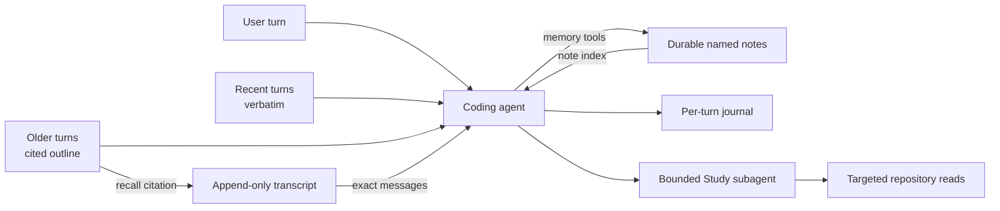
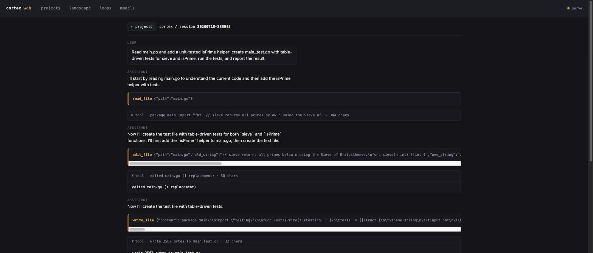

# Cortex

[](https://github.com/dereksantos/cortex/actions/workflows/test.yml)
[](go.mod)
[](LICENSE)

<p align="center">
  
</p>

**Cortex is a coding agent for small and local models. It manages its own
context, keeps its own notes, and learns from its past sessions.**

Cortex keeps recent turns in the context window word for word. It replaces
older turns with a short outline. Each outline line has a citation. The
agent uses the `recall` tool to get the exact messages back from disk.

The agent writes notes about decisions and constraints that it must keep.
Each turn starts with an index of these notes. Between sessions,
`cortex learn` reads the turn journal and saves the notes that the agent
did not write.

I use Cortex every day to develop Cortex, and Cortex also fixes its own
issues. See [Cortex builds Cortex](#cortex-builds-cortex).
Cortex keeps all of its data in plain files under `.cortex/`. You can read,
edit, or delete these files.

[`Quick start`](#quick-start) · [`Cortex builds Cortex`](#cortex-builds-cortex) ·
[`How memory works`](#how-working-memory-works) ·
[`Project status`](#project-status) · [`Roadmap`](ROADMAP.md)

## Example

Cortex finds and fixes a bug in a small project. The model is qwen3.8-27b
on a local server. The playback is 1.5 times faster than real
time.


To record this demo again, see
[`docs/assets/demo/demo.tape`](docs/assets/demo/demo.tape).

A long session does not keep all old messages in the context window. When
an old turn is necessary again, the agent recalls it:

```text
you     Fix the cache invalidation bug we discussed earlier.

cortex  The relevant implementation turn is now in the session outline:
        [@session/20260710-143210#m42-58]

        I'll recall it before changing the cache behavior.

tool    recall @session/20260710-143210#m42-58

cortex  The earlier decision was to preserve the stable prompt prefix and
        invalidate only the memory-index suffix. I'll verify that invariant
        against the current code before editing it.
```

The outline does not replace the history. The transcript on disk keeps all
messages. Cortex only adds to the transcript. It does not change or delete
messages.

Type `/context` to see the context window. The map shows each part of the
window, the demotion watermark, and how much of the prompt the provider
served from its cache:


## Cortex builds Cortex

Cortex fixes issues in its own repository. A self-development loop runs
these steps with no person at the keyboard:

1. The loop selects an open issue from the queue.
2. Cortex plans the change, edits the code, and runs the tests.
3. Cortex opens a pull request.
4. Claude reviews the pull request. Claude cannot edit the code.
5. Cortex fixes each review finding, and the review starts again.
6. A pull request merges only after the review approves it and CI passes.

From 2026-09-28 to 2026-10-10, the loop merged
[49 pull requests](https://github.com/dereksantos/cortex/pulls?q=is%3Apr+is%3Amerged+label%3Acortex-loop).
Cortex wrote about 85% of the commits in them. Claude wrote the other
commits, mostly to merge `main` into the branches and to fix tests. Cortex used two
open models: a 27B model on a local machine and a 177B model on a second
machine.

The reviews also find patterns in the mistakes that Cortex makes. We write
each pattern as an issue, and the loop fixes it. These are some examples:

- [#223](https://github.com/dereksantos/cortex/pull/223): per-turn
  checkpoints and the `/undo` command.
- [#212](https://github.com/dereksantos/cortex/pull/212): after Cortex
  reads web content in a turn, more shell commands need your approval.
- [#176](https://github.com/dereksantos/cortex/pull/176): `edit_file`
  failed again and again because Cortex edited from an old view of the
  file. Now a failed edit shows the current text of the nearest lines.

## Design

Cortex treats the context window as a cache. Most old turns are not
necessary for the next step. A summary of old turns loses the details that
you can need later. Thus Cortex does not delete old turns or summarize
them.

Cortex applies these rules:

- Recent turns stay in the window word for word.
- Older turns become one outline line each, with a citation.
- The `recall` tool gets the exact messages for a citation from the
  transcript.
- The start of the prompt stays the same from turn to turn. This lets the
  provider cache it, and it makes local models faster.

Durable memory is the decision of the agent. It is not automatic. The agent
writes a named note when a fact must stay after the session ends. Each turn
starts with an index of all notes. The `cortex learn` command runs a
background pass over the turn journal. It saves notes that the foreground
agent did not write.

Cortex does not use embeddings or a hidden database. Sessions, notes, the
journal, and citations are plain files under `.cortex/`.

## Install

Cortex operates on **macOS and Linux**. We do not build or test it on
Windows. You also need a model, local or hosted. See
[Quick start](#quick-start).

**Option 1: install script.** The script installs the latest release binary
to `~/.local/bin`. If no release binary is available, it uses
`go install`. You can read [`scripts/install.sh`](scripts/install.sh)
before you run it.

```bash
curl -fsSL https://raw.githubusercontent.com/dereksantos/cortex/main/scripts/install.sh | bash
```

**Option 2: Go 1.26 or later.**

```bash
go install github.com/dereksantos/cortex/cmd/cortex@latest
```

**Option 3: build from source.**

```bash
git clone https://github.com/dereksantos/cortex.git
cd cortex
go build -o bin/cortex ./cmd/cortex
```

Make sure that the binary runs:

```bash
cortex --version   # or ./bin/cortex --version
```

The `cortex version` command gives the same result. The version string
includes the short git revision of the build. To set a different version,
use this command:
`go build -ldflags "-X main.Version=1.2.3" -o bin/cortex ./cmd/cortex`.

### Install with a coding agent

If you use a coding agent, you can give it this prompt:

```text
Install the Cortex coding harness (github.com/dereksantos/cortex) on this
machine:

1. Run: curl -fsSL https://raw.githubusercontent.com/dereksantos/cortex/main/scripts/install.sh | bash
   (or `go install github.com/dereksantos/cortex/cmd/cortex@latest` if a
   Go 1.26+ toolchain is available and you prefer it).
2. Verify `cortex --version` prints a version, and tell me what it printed.
3. Read the "Quick start" section of
   https://raw.githubusercontent.com/dereksantos/cortex/main/README.md and
   set up `.cortex/config.json` in my current project. Ask me one question
   first: local Ollama model, or an OpenRouter API key?
4. Don't launch cortex yourself — it's an interactive REPL. Just tell me
   it's ready and that I start it by running `cortex`.
```

## Quick start

### 1. Install Cortex

See [Install](#install). The commands below use `./bin/cortex`. If you
used `go install` or the install script, use `cortex`.

### 2. Configure a backend

#### Local: Ollama

1. Pull a model.
2. Create a configuration file in the project.
3. Set the model for the `code` role and the `study` role. Ollama does not
   give the data that Cortex uses to select models automatically.

```bash
ollama pull qwen2.5-coder:7b
mkdir -p .cortex
cat > .cortex/config.json <<'JSON'
{
  "backend": {
    "endpoint": "http://localhost:11434/v1"
  },
  "models": {
    "code":  { "model": "qwen2.5-coder:7b", "window": 32768 },
    "study": { "model": "qwen2.5-coder:7b", "window": 32768 }
  }
}
JSON
```

#### Hosted: OpenRouter

Put the API key in an environment variable. The configuration file
contains only the name of the variable.

**Default models.** If you do not set `models`, Cortex selects a free model
from a curated list. It uses the same model for the `code` role and the
`study` role. The list prefers models with large context windows and good
coding results.

```bash
export OPENROUTER_API_KEY='...'
mkdir -p .cortex
cat > .cortex/config.json <<'JSON'
{
  "backend": {
    "type": "openrouter",
    "endpoint": "https://openrouter.ai/api/v1",
    "key_env": "OPENROUTER_API_KEY"
  }
}
JSON
```

The curated list is in `cmd/cortex/curated.go`. If a model is retired or
fails during a session, Cortex changes to the next model on the list. This
applies to curated models and to the models that you set. Cortex prints one
line with the old model, the new model, and the reason. It also writes a
journal entry. The `cortex model` command shows recent entries. Cortex does
not change your configuration file. See
[`docs/model-self-healing.md`](docs/model-self-healing.md) and
`network.self_heal` in [`docs/configuration.md`](docs/configuration.md).

**Set your own models.** Replace the model IDs with the models that you
want for the `code` role and the `study` role:

```bash
export OPENROUTER_API_KEY='...'
mkdir -p .cortex
cat > .cortex/config.json <<'JSON'
{
  "backend": {
    "type": "openrouter",
    "endpoint": "https://openrouter.ai/api/v1",
    "key_env": "OPENROUTER_API_KEY"
  },
  "models": {
    "code":  { "model": "qwen/qwen3-coder", "window": 131072 },
    "study": { "model": "deepseek/deepseek-r1" }
  }
}
JSON
```

### 3. Start a session

```bash
./bin/cortex
```

On the first run, the model sends a short greeting before the prompt
shows. If the greeting shows, the backend operates correctly.

If you have no configuration and you start `cortex` in a terminal, Cortex
starts a setup procedure:

1. Cortex asks for an OpenRouter API key. You can get a free key at
   https://openrouter.ai/keys.
2. Cortex keeps the key in the macOS Keychain.
3. Cortex writes `~/.cortex/config.json` with a free curated model.

To skip the setup, push Enter with no key. If the input is not a terminal
(for example, a script or CI), Cortex prints one line of help. See
[`docs/configuration.md`](docs/configuration.md) for all the steps.

This is a good first prompt:

```text
Study this repository, explain its architecture, and identify the smallest
high-value improvement. Don't change anything yet.
```

Cortex saves each session to `.cortex/sessions/<id>.jsonl`. To continue a
session, use this command:

```bash
./bin/cortex resume
```

If you do not give a session id, `resume` opens a list of sessions:

- Type text to filter the list by prompt, session id, or model.
- Push Enter to continue the selected session.
- Push ESC to continue the latest session.

If you give a session id, Cortex continues that session. If the output is
not a color terminal (a pipe, `NO_COLOR`, or `CORTEX_LOOP_RENDER=0`),
Cortex continues the latest session and does not open the list.

### Use this README as input

When a backend is configured, Cortex can read this README and help you
start. To get a short guide for your setup, use the Study subagent:

```bash
./bin/cortex study README.md \
  "Explain how to start Cortex with my backend, then suggest a safe first task"
```

To let the coding agent examine your checkout, use one headless turn:

```bash
./bin/cortex turn \
  "Read README.md, inspect this checkout, and tell me whether I am ready to run Cortex. Do not change anything."
```

## How working memory works



Cortex keeps three different records:

1. **Transcript: the full session history.** Cortex saves every message.
   Demotion removes a message from the context window, but not from the
   transcript.
2. **Working set: the data that the model sees now.** The first part of the
   prompt contains the system prompt, the outline, and the note index. This
   part stays the same between turns. The last part contains recent turns
   word for word. When the window becomes too full, Cortex moves the oldest
   full turns into the outline.
3. **Named notes: memory between sessions.** The model decides which facts
   to keep. It uses `memory_write`, `memory_read`, `memory_search`, and
   `memory_forget` to manage the notes.

The `recall` tool connects the working set to the transcript. The
`/compact` command makes a summary of the session. It is a safety
procedure, not the primary memory method. Cortex also writes each turn to
an append-only journal. The `study` tool can read the journal. The
`cortex learn` command reads the journal to find new notes.

For the full design, read
[`docs/context-architecture.md`](docs/context-architecture.md),
[`docs/memory-tools.md`](docs/memory-tools.md), and
[`docs/learning-loop.md`](docs/learning-loop.md).

## Tools

- **Find code:** `outline`, `grep`, `read_file`, and the `study` subagent
  find the necessary code. They do not put the full repository into
  context.
- **Change code:** `write_file`, `edit_file`, and `remove_path` change
  files. `remove_path` operates only in the workspace.
- **Make sure that changes work:** `bash` runs builds and tests. A risk
  gate examines each command first.
- **Search the web:** `web_search` and `fetch_url` give limited access to
  public web pages. Only the coding agent can use them.
- **Remember:** the `memory_*` tools manage notes. `recall` gets the exact
  messages of old turns.
- **Manage context:** the `context_*` tools remove or merge outline lines.
  They also move the demotion watermarks, within limits.
- **Delegate:** the `agent` subagent does one task. It reads, edits, and
  runs `bash` to make sure that the change works. Then it reports the
  result.

The Study subagent can only read. It uses `outline`, `grep`, and
`read_file` on small ranges. It cannot edit files, run commands, see the
conversation, or start other subagents.

The `agent` subagent can write files, edit files, and run `bash`. These
limits apply to it:

- It cannot start a subagent.
- It refuses Risky shell commands.
- It cannot use `recall`, the memory tools, or the context tools.

The `agent` subagent uses the current coding model. To use a different
model, give the `model` argument. See [`docs/agent-tool.md`](docs/agent-tool.md)
for the design. To disable the tool, set `tools.enable_agent` to false.

<details>
<summary><strong>All tools</strong></summary>

| Tool | Purpose |
|---|---|
| `read_file` | Reads a file or a range of lines. For a large file, it tells the agent to use Study, or it gives a Go declaration skeleton. It attaches a full image file (png, jpeg, gif, webp) for vision models. It refuses an image for a text-only model, for a file that is too large, or in a subagent. |
| `write_file` | Creates or replaces a file. |
| `edit_file` | Replaces exact text in a file. It also accepts whitespace differences and multiple edits at a time. If it fails, it gives the line numbers of the matches or the nearest text. If it succeeds, it shows the changed lines. |
| `study` | Reads a large file or directory and gives a summary for a goal. |
| `agent` | Gives one task to a subagent that can read, edit, and run `bash`. |
| `outline` | Shows the structure of a project or a file without its full contents. |
| `grep` | Finds text and gives a limited list of `file:line:text` results. |
| `bash` | Runs a shell command after the risk gate examines it. |
| `remove_path` | Deletes a path in the workspace. It refuses the workspace root, `.git`, and `.cortex`. |
| `web_search` | Searches the public web. It gives titles, URLs, and short extracts. |
| `fetch_url` | Gets limited text from a public HTTP(S) URL. It refuses private and local addresses. |
| `scan_landscape` | Finds agent harnesses and local model runtimes in your home directory. It only checks if they exist. It does not read projects. It writes a `landscape` note. |
| `memory_write`, `memory_read` | Creates or updates a named note, or reads a full note. |
| `memory_search`, `memory_forget` | Finds notes by keyword, or deletes a note. |
| `recall` | Gets the exact messages for an outline citation. With `budget`, it gives a short summary. |
| `context_evict` | Removes an outline line from the working set. The transcript does not change. |
| `context_merge` | Merges adjacent demoted turns into one outline line. |
| `context_adjust_watermarks` | Moves the demotion watermarks, within limits. |

</details>

## Commands

<details>
<summary><strong>CLI and REPL commands</strong></summary>

```text
cortex                              start the interactive REPL
cortex --version | cortex version   print the version
cortex resume [id]                  continue a session; with no id, select one
                                    from a list (or the latest when not a TTY)
cortex turn [--session id] [--plan] [--json] <input...>
                                    run one headless turn; --plan makes a plan,
                                    then runs each step as a separate turn (as /plan)
cortex study <path> [goal...]       run the read-only Study subagent
cortex learn [--project <name>]     run one learning pass over the journal
cortex change <start|commit|status> manage one git change at a time
cortex serve [--port <n>]           start the local web UI (loopback only)
cortex scan [--json] [--root <path>] [--register]
                                    find projects in the configured roots
cortex project <add|list|remove>    manage the project registry
cortex project trust <add|remove|list>
                                    manage the trusted workspaces (the
                                    post-edit hook runs only in these)
cortex project commands [--json] [--project <name>]
                                    show the format, lint, test, and build
                                    commands of the project
cortex discord                      start the Discord adapter
cortex study-eval                   run the Study acceptance test
cortex model [--json]               show the code and study models, the models
                                    that the backend serves, and a models
                                    block for the RAM of this machine
```

With `cortex turn`, stdout contains only the answer. The resume banner and the
session id go to stderr.

`cortex serve` starts a local web UI for your projects and sessions. This
image shows a real session. The agent reads `main.go`, adds a helper, and
writes table-driven tests:



| REPL command | Purpose |
|---|---|
| `/help` | Shows the list of commands. |
| `/context` | Shows a map of the context window and the cache use of the last request. |
| `/compact` | Makes a summary of the session now, to free context. |
| `/plan <task>` | Makes a plan in one turn, then runs each step as a separate turn. This is the same as `cortex turn --plan`. If a step cannot reproduce a reported problem, its reply starts with "Not reproduced:" and the evidence. |
| `/clear` | Starts a new session. |
| `/undo [N]` | Reverts the file changes of the Nth most recent turn (the default is 1). It shows the changed files and tells the model about the revert. |
| `/sessions` | Shows a list of saved sessions. Type to filter. Enter continues a session. ESC closes the list. |
| `/last` | Shows all tool calls of the last turn in full, with diffs and output. Ctrl-O does the same. |
| `/memory` | Shows the saved notes. You can read them, but not change them. The agent changes notes with the memory tools. |
| `/model [name]` | Changes the coding model. With no name, it shows a list. |
| `/hook off\|format\|all` | Decreases the post-edit hook level for this session. It cannot increase the level. With no argument, it shows the current level. |
| `/quit`, `/exit` | Stops Cortex. Ctrl-D also stops Cortex. |

In the REPL, Tab completes slash commands, `/model` ids, and `@path` file
mentions. Alt-Enter adds a new line. An `@path` mention attaches the file
to the turn:

- Cortex puts a small file into the turn as text.
- For a large file, Cortex attaches an outline. These are the same rules
  as `read_file`.
- An `@` is a mention only at the start of a word. Email addresses and
  names such as `@types/node` stay as text.
- If the path is not a file that Cortex can read, the text does not change.

To save or delete a note, tell the agent in plain language. The agent uses
the `memory_*` tools.

</details>

## Configuration

Cortex reads the configuration in this sequence. A later layer overrides
the fields of an earlier layer:

1. `~/.cortex/config.json` (or `$CORTEX_HOME/config.json`)
2. The nearest `.cortex/config.json` in the project
3. The `CORTEX_BACKEND` environment variable (endpoint only)

```json
{
  "backend": {
    "type": "openrouter",
    "endpoint": "https://openrouter.ai/api/v1",
    "key_env": "OPENROUTER_API_KEY"
  },
  "models": {
    "code":  { "model": "qwen/qwen3-coder", "window": 131072 },
    "study": { "model": "deepseek/deepseek-r1" }
  }
}
```

There are two model roles. The `code` role is the coding agent. The `study`
role is the Study subagent and the summarizer. With an `openrouter` backend
and no `models` section, Cortex selects a free curated model for the two
roles. [`docs/configuration.md`](docs/configuration.md) is the reference for
all `tools.*` settings, environment variables, and API key options.

## Safety and privacy

Cortex keeps its data on your computer. If you use a hosted model, Cortex
sends prompts and some tool results to the provider.

Cortex keeps its data under `.cortex/`. In a git workspace, the first
session writes `.cortex/.gitignore` with one line, `*`. Thus `git add -A`
does not add transcripts, the journal, or notes. Cortex does not change
your own `.gitignore`.

- Cortex puts each shell command into one of three classes: **Safe**,
  **Risky**, or **Blocked**. You must approve a Risky command. A headless
  session refuses it.
- `remove_path` deletes only in the workspace. It cannot delete the
  workspace root, `.git`, or `.cortex`.
- `fetch_url` accepts only public HTTP(S) addresses. It examines each
  redirect and limits the size of the response.
- Study can only read. It has limits on iterations, output tokens, bytes
  read, and time. It also stops when it makes no progress.
- Demotion does not delete data. The transcript keeps the full history.

See [`SECURITY.md`](SECURITY.md) to report a vulnerability.

## Evidence

We continue to evaluate the working-memory design. Deterministic tests use
the real turn path. They make sure that:

- each session message is in the context window or can be recalled with a
  citation;
- the working set stays within its configured budget;
- demotion keeps each tool call together with its result;
- outline labels and citations stay correct after folds and resumes;
- the start of the prompt stays the same between normal turns, for cache
  reuse;
- notes stay between sessions, and the agent can update and delete them;
- Study can only read, and it stays within its limits.

Live evaluations against real models also test recall, prompt size, memory,
and Study accuracy. An environment variable enables them. These
evaluations have limits. The context runs are short. Study results change
with the model and backend. Recall is more difficult when the outline does
not show that an old turn is relevant.

For the methods and results, read
[`docs/context-architecture.md`](docs/context-architecture.md),
[`docs/memory-tools.md`](docs/memory-tools.md), and
[`docs/study-subagent.md`](docs/study-subagent.md).

## Project status

**Available now**

- interactive, headless, resumed, and Discord sessions;
- a two-part context window with exact recall;
- notes that the model manages, a journal of each turn, and a background
  learning pass (`cortex learn`);
- model self-healing: Cortex finds failures, identifies their cause, and
  changes to a curated free model;
- tools to code, find code, run commands, search the web, and manage
  context;
- different models for the `code` and `study` roles, on OpenAI-compatible
  backends.

**In progress**

- installation and release packages;
- support for more models and backends, and reliable tool calls;
- evaluation of recall in long sessions;
- stable configuration and context policy;
- learning methods other than the journal pass.

**Not planned now**

- a full browser or a tool that runs JavaScript on web pages;
- the old retrieval, rerank, and distill pipeline;
- claims of better model quality before longer evaluations exist.

Earlier versions included a daemon, a dashboard, a larger CLI, and a
Claude Code integration. We removed them to focus on one binary. Their
history is in [`docs/archive.md`](docs/archive.md).

## Development

```bash
go build ./cmd/cortex
go test ./...
go vet ./...
./scripts/check.sh          # gofmt, go vet, and golangci-lint
```

These are the main packages:

```text
cmd/cortex/        binary, REPL, adapters, session setup, shared loop
internal/agent/    tool-call types and loop limits
internal/cache/    the two-part working set
internal/tools/    tool declarations and implementations
internal/outline/  structure maps of projects and files
internal/memory/   the note store
internal/journal/  the append-only event log
pkg/llm/           Anthropic, Ollama, OpenRouter, and OpenAI-compatible providers
pkg/config/        layered configuration
```

## Documentation

- [`CLAUDE.md`](CLAUDE.md): guide for agents and contributors
- [`ROADMAP.md`](ROADMAP.md): direction and status
- [`docs/configuration.md`](docs/configuration.md): all configuration fields, `tools.*` settings, and environment variables
- [`docs/context-architecture.md`](docs/context-architecture.md): the two-part context window and citation recall
- [`docs/memory-tools.md`](docs/memory-tools.md): notes that the model manages
- [`docs/learning-loop.md`](docs/learning-loop.md): the background learning pass
- [`docs/model-self-healing.md`](docs/model-self-healing.md): model discovery, fallback, and diagnosis
- [`docs/engine-unification.md`](docs/engine-unification.md): the shared agent loop
- [`docs/study-subagent.md`](docs/study-subagent.md): the read-only Study subagent
- [`docs/archive.md`](docs/archive.md): the project before the current design

## License

[MIT](LICENSE)
